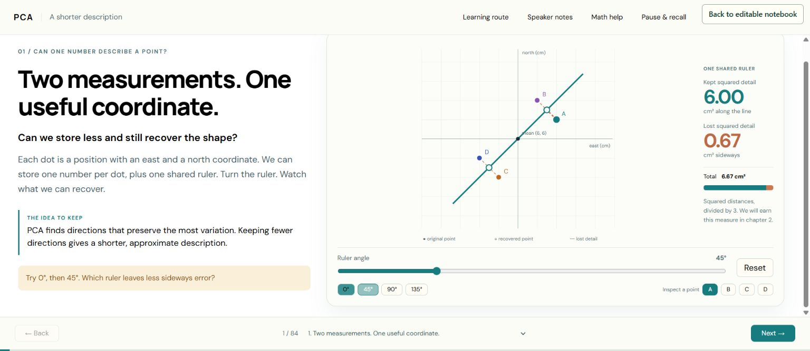

# PCA: a shorter description

An **84-scene interactive masterclass** built with native **marimo-studio 0.2.3**, a reactive Python notebook, React, and Reveal.js.

Start with a visible question: can one number describe a point that has two coordinates? Build an encoder and decoder, derive the covariance objective, prove the global optimum, then decide when that optimum solves the actual task. Mathematical refreshers enter where the argument needs them.



## Open the course

On Windows, install [uv](https://docs.astral.sh/uv/getting-started/installation/) and use PowerShell 7 with Chrome or Edge. From this directory:

```powershell
.\Open-Course.ps1
```

The launcher builds the presentation, starts the authenticated notebook and presentation as hidden background processes, and opens **http://localhost:2729/lesson/**. It requests Python 3.12 and installs pinned dependencies on first use. Internet access is needed for initial installation and the current external font/KaTeX stylesheets.

Use **Back to editable notebook** at the top right. The link carries the current local editor authentication and opens Studio with the notebook beside the slides. If a restored notebook leaves the preview at **Connecting to the Python runtime**, press the yellow **Run all** triangle in the notebook. This recovery was exercised in Chrome. The notebook contains a link back to the full-screen presentation.

The full-screen presentation and separate editor have separate Python sessions. Their slider values do not synchronize with each other. Within each session, the native controls and its view share the reactive notebook state.

The launcher prints a run-record path. Stop just that run with:

```powershell
.\Open-Course.ps1 -StopRun .runtime/run-YYYYMMDD-HHMMSS-ID/processes.json
```

Use the actual printed path. After a machine restart, run `Open-Course.ps1` again. An occupied port causes a clear error; the launcher does not terminate unrelated processes. Alternate ports are supported:

```powershell
.\Open-Course.ps1 -EditorPort 2738 -PresentationPort 2739
```

Generated login URLs, process records, and logs stay in ignored `.runtime/` files. They are not part of the public repository. `Start-Lesson.ps1` also supports separate foreground processes for development; the one-command launcher is the recommended entry.

## Learn through eight questions

| Scenes | Question | What you construct or explain |
|---|---|---|
| 1–7 | Can one number describe a point? | Shared ruler, score, decoder, center, perpendicular foot |
| 8–15 | How do we keep the right detail? | Pythagoras, fixed total, score variance, unit constraint, new point |
| 16–24 | Why does covariance appear? | Squared-score expansion, signed products, matrix entries, affine mean proof |
| 25–34 | Why do eigenvectors win? | Tangent change, gradient, constrained candidates, global bound, ties |
| 35–46 | What if we keep more directions? | Shape flow, projectors, constructive capacity weights, top-k proof, loss, SVD |
| 47–58 | How do we use PCA well? | Metric, units, standardization, whitening, component budget, validation, code checks |
| 59–72 | When does PCA mislead us? | Nuisance variation, outliers, curves, instability, alternatives, applications, native lab |
| 73–84 | Can you explain and transfer it? | Six readiness lenses, fresh calculations, proof reconstruction, study design, delayed retrieval |

The complete rank-one global proof arrives at scene 32. The spectral and SVD existence theorems are explicitly invoked; the course does not pretend to prove those background theorems. The top-k optimality argument itself is supplied.

Use the slide menu or **Learning route** to jump. **Math help** stays beside the current scene. **Pause & recall** supplies a chapter-specific reconstruction task. **Speaker notes** contains an exact event-cued script, also exported to [SPEAKER_NOTES.md](SPEAKER_NOTES.md).

There are 31 diagnostic multiple-choice tasks, 17 scenes with open-reasoning rubrics, eight chapter recall tasks, and 113 authored mathematical steps. These counts describe content, not learning effectiveness. Some explanations use progressive equation reveals; others use geometric construction, numerical checks, label revelation, transformations, or case decisions.

Explain-back drafts persist while navigating this page, but not after a reload. Copy your work before closing it. The course provides authored feedback and self-review; it does not submit responses to an AI tutor or claim to grade free text automatically. A reload starts the course at scene 1.

## Notebook and source

| File | Purpose |
|---|---|
| [pca_lesson.py](pca_lesson.py) | Editable reactive notebook, native controls, data and mathematical companion |
| [pca_math.py](pca_math.py) | NumPy reference calculations and compact projection payloads |
| [v/lesson/src](v/lesson/src) | Native Studio React/Reveal view and interactive illustrations |
| [author_core.py](author_core.py) | Author-owned source that regenerates the first 34 scene records |
| [SPEAKER_NOTES.md](SPEAKER_NOTES.md) | All 84 narrated scripts and cue points |
| [SOURCES.md](SOURCES.md) | Technical and application references |
| [process/COVERAGE.md](process/COVERAGE.md) | Requested capabilities mapped to actual scenes |
| [process/REPORT.md](process/REPORT.md) | Research, repairs, runtime evidence, and remaining limits |
| [process/review](process/review) | Original independent review and subsequent rechecks |

Local browser controls calculate immediate illustration states from the fixed notebook fixture. Scene 71 uses actual `marimo.ui` controls, reruns Python, and projects the resulting live data into the slide. The view is a native Studio view, not a separate website styled to resemble one.

## Verification and evidence limits

The Windows clean-start launcher, authenticated notebook return, native recomputation, representative controls, and all 84 scene entry states were exercised. Numerical checks compare browser geometry with NumPy and test the notebook across 3,077 angle/outlier combinations. See the [report](process/REPORT.md) for exact scope and revisions.

The research inventory has 31 video candidates. Five were substantively inspected through transcripts across the research passes; many others remained inaccessible beyond metadata despite attempts. Two StatQuest projection frames were visually inspected, without listening. Complementary creator/primary written materials supply further technical and teaching evidence. This is not a claim that 31 complete videos were watched.

The course is a **reviewed candidate**, not an established superior educational treatment. Human learning, delayed retention, comparative performance against leading tutorials, narrated audio delivery, and audience reach have not been measured. The prose is written in a plain style; the requested 80% ASD-STE100 compatibility target is **not certified**. Mechanical prose measurements are reported separately from a vocabulary/usage audit.

The current pinned Studio build sometimes prints a Windows temporary-directory cleanup traceback after reporting a successful build and returning exit code 0. The generated presentation was served and tested; the cleanup warning is preserved in local build output. No framework sandbox or authentication protections were disabled to make the notebook return work.

## Run checks

```powershell
uv run --python 3.12 --with 'marimo-studio[deno]==0.2.3' --with 'numpy==2.5.3' python -m unittest test_pca_math test_navigation
uv run --python 3.12 --with 'marimo-studio[deno]==0.2.3' deno test --allow-read --config v/lesson/deno.json v/lesson/test_course.ts
uv run --python 3.12 --with 'marimo-studio[deno]==0.2.3' deno check --config v/lesson/deno.json v/lesson/src/main.tsx
```

The frozen frontend lockfile and Python version requirements are committed. A fresh Windows startup was exercised here; Linux/macOS launcher portability and fully offline operation were not verified.
